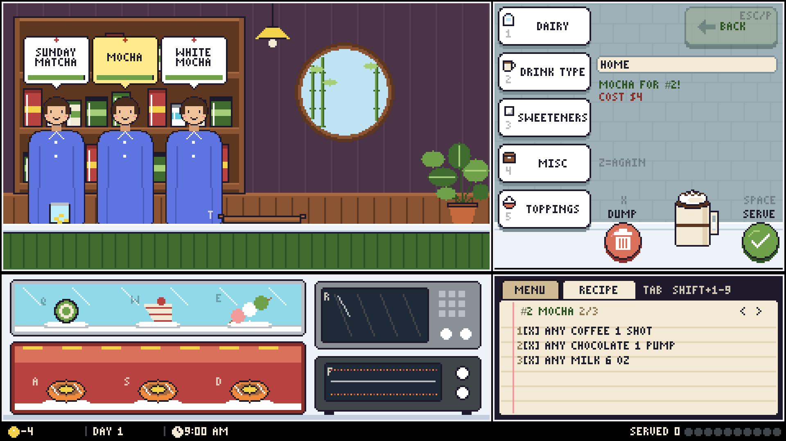
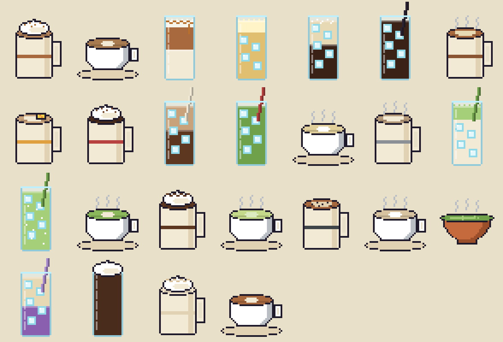

# Matcha Manager

A pixel-art café game made in Unity. Customers line up and order drinks (and sometimes a snack), and you build each drink by picking ingredients from a drink tree. Serve it before they run out of patience. Making drinks fast pays more, cheap ingredients keep more profit, and the orders get pickier every day.



## Getting started

1. Install **Unity 6000.6.7f1** (Unity Hub → Installs).
2. In Unity Hub, **Add project from disk** → pick the `MatchaManager/` folder.
3. In the editor menu bar:
   1. **Matcha → Import Drink Tree** reads the drink tree from the Obsidian vault (see [The drink tree](#the-drink-tree)). Unity asks for the vault folder the first time.
   2. **Matcha → Build Scene** builds `Assets/Scenes/Main.unity` from the art, recipes and settings.
4. Press **Play**, then pick **NEW GAME** and a difficulty.

Run **Build Scene** again after changing art, recipes or code that the scene builder sets up. It rebuilds the scene from scratch, so don't hand-edit `Main.unity`.

## How to play

- **Customers** wait in line, order at the counter, then wait at one of three pickup spots, each with a ticket and a patience bar. Click a ticket (or use ← →) to show that order in the **RECIPE** notebook.
- **The drink station** (top right) works like a file browser: folders such as *Dairy* or *Drink Type*, with ingredients inside. Each click pours one portion into the glass. The recipe checklist ticks lines off as you go.
- **Serve** with the round button. The drink goes to the customer whose order it matches, oldest first. When the cup matches an order, the glass turns into the finished drink and the notebook switches to that customer.
- **Snacks:** cold ones go straight onto the tray. Hot ones must be heated in the microwave or toaster oven, but not left until they burn.
- **Order changes** get more common as the days go by and on harder difficulties:

  | Change | Example | Meaning |
  |---|---|---|
  | NO | NO MILK | leave that line out |
  | EXTRA | EXTRA CANE SUGAR x2 | more portions |
  | WITH | WITH CEREMONIAL MATCHA | a specific choice for an ANY line, never the cheapest one |
  | ADD | ADD CHEESE FOAM | something the recipe doesn't have |

- **Mumbled orders** (Medium and Hard) hide the name and the changes. You get three ways to deal with them:
  - **Watch.** A few clear letters slide along the hidden order on the ticket and in the notebook.
  - **Ask.** Press **G** and pick from three guesses. A wrong guess drains every waiting customer's patience.
  - **Make it early.** The sooner you make it without asking, the bigger the bonus.
- **Costs:** every portion and snack costs coins as you use it, and dumping wastes them. Customers can't taste the difference, so the cheapest choice on an ANY line earns the most.
- **Pay** depends on the patience bar:

  | Bar | Pay |
  |---|---|
  | 🟢 Green | full price + tip + fast bonus |
  | 🟡 Yellow | full price + tip |
  | 🔴 Red | only part of the price, no tip |

- **Days** run from 9 AM to 5 PM. The status bar dots fill toward the day's goal of happy customers. The end-of-day summary shows sales, ingredient costs and profit, and the game saves automatically.

## Controls

| Key | Action |
|---|---|
| **1–5** | Drink slots. A number that pours an ingredient jumps back to HOME |
| **SHIFT+1–9** | Jump to that line of the recipe checklist: open an ANY or WITH line's folder, pour a named ingredient, or pick up the order's snack |
| **Z** | Pour the last ingredient again |
| **BACKSPACE / P** | Back up a folder (and close the guess bubbles) |
| **ESC** | Pause: **1** resume, **2** settings, **3** quit to title. On the settings page: **1–2** music, **3–4** sound, **5** fullscreen, **6** key hints |
| **SPACE / ENTER** | Serve |
| **X** | Dump the cup (costs every waiting customer some patience) |
| **Q W E** | Cold snacks |
| **A S D** | Hot snacks |
| **R / F** | Microwave / toaster oven |
| **T** | Toss the tray's snack |
| **← →** | Switch which customer the notebook shows |
| **G**, then **1–3** | Ask a mumbling customer, then pick a guess |
| **TAB** | Switch MENU / RECIPE |
| **M** | Mute everything |
| **F1** | Hide / show key hints |

On the title screen, **ENTER** continues or starts a game, **N** starts a new game and **S** opens the settings. Pick the difficulty with **1 2 3** or **E M H**.

## Pause and settings

**ESC** during the day stops the clock, the customers and the snacks. From the pause menu you can resume, open the settings, or quit to the title (two clicks, because quitting replays the day from its start). A built game also pauses itself when you switch to another window.

The settings are also on the title screen:
- music volume
- sound volume
- fullscreen (only applies in a built game)
- key hints

They're kept in PlayerPrefs, separate from the save, so a new game keeps them.

## Drinks

There are 24 recipes. Together they use every ingredient in the drink tree.



Two pairs overlap on purpose: a Mocha made with white chocolate is also a White Mocha, and a Sunday Matcha made with pistachio milk is also a Pistachio Matcha. An overlapping drink goes to whoever has waited longest.

## Project layout

```
MatchaManager/                 the Unity project
  Assets/Scripts/              game code (CustomerManager, Cup, DrinkBrowser, Order, DayCycle, ...)
  Assets/Editor/               scene builder, importers, balance simulator, headless checks
  Assets/Data/DrinkTree/       one DrinkNode asset per folder / ingredient (made by Import Drink Tree)
  Assets/Data/Recipes/         DrinkRecipe assets
  Assets/Data/Snacks/          Snack assets
  Assets/Data/Balance*.asset   one Balance asset per difficulty (Easy / Medium / Hard)
  Assets/Art/                  exported pixel art: Layers, Icons, Cup, Drinks, Font
  Assets/Audio/                sound effects
  Tools/export_art.sh          splits the Aseprite file into Assets/Art/Layers
  Tools/make_sfx.py            synthesizes every sound effect (pure Python)
Sprites/
  background_claude.lua        Aseprite script that draws all the art
  background_claude.aseprite   its output: the layered 480x270 screen
docs/                          README images
```

## The drink tree

The ingredient tree comes from an Obsidian vault. `Drink Tree.md` is the root, and every `- [[Link]]` list item in a note is a child:

- A link to a note that exists becomes a **folder**.
- A link to a missing note becomes an **ingredient**.

**Matcha → Import Drink Tree** turns the vault into `DrinkNode` assets. It keeps your Inspector tweaks, removes nodes the vault no longer has, adds any missing starter recipes, and warns about ingredients no recipe uses.

The default vault path is in `DrinkTreeImporter.cs`. Unity asks for a folder if that path doesn't exist.

## Art

All art is drawn in code by `Sprites/background_claude.lua`, run with Aseprite's command line:

```bash
ASE="$HOME/Library/Application Support/Steam/steamapps/common/Aseprite/Aseprite.app/Contents/MacOS/aseprite"
"$ASE" -b --script-param out=Sprites/background_claude.aseprite \
  --script-param icondir=MatchaManager/Assets/Art/Icons \
  --script-param cupdir=MatchaManager/Assets/Art/Cup \
  --script-param drinkdir=MatchaManager/Assets/Art/Drinks \
  --script-param fontdir=MatchaManager/Assets/Art/Font \
  --script Sprites/background_claude.lua
MatchaManager/Tools/export_art.sh
```

| Param | What it exports |
|---|---|
| `out` | the layered screen |
| `icondir` | 8×8 drink-tree icons |
| `cupdir` | powder and ice textures |
| `drinkdir` | 40×48 finished drinks |
| `fontdir` | the 3×5 pixel font atlas |

`export_art.sh` splits the screen's layers into `Assets/Art/Layers`. After exporting, run **Build Scene** (and **Matcha → Build Pixel Font** if the font changed).

## Sound

```bash
python3 MatchaManager/Tools/make_sfx.py
```

This writes one WAV per `Sfx` entry into `Assets/Audio`.

## Music

Drop tracks into `MatchaManager/Assets/Audio/Music/`, then run **Build Scene**. The file name decides where a track plays:

| Name starts with | Plays | Example |
|---|---|---|
| `Title` | title screen | `Title.ogg` |
| `Shop` | while the shop is open | `Shop 1 - Morning.ogg`, `Shop 2 - Rush.ogg` |
| `Summary` | end-of-day summary | `Summary.ogg` |

- A single track loops. Several Shop tracks play one after another, in name order.
- Switching between screens crossfades, and the music turns down while paused.
- Any format Unity reads works (.ogg, .mp3, .wav). Music imports as streamed Vorbis.
- The fade time and volumes are on the **Music** object's `MusicPlayer`. Build Scene rebuilds the scene, though, so for lasting changes edit the defaults in `MusicPlayer.cs`.

## Tuning

Everything that makes the game easier or harder is in the Inspector. **Build Scene** fills in defaults once and then leaves your edits alone.

- **Balance assets (one per difficulty):**
  - arrivals
  - patience: starting seconds + seconds per key press the order needs
  - fast and late zones
  - order changes per day
  - mumble chance and peek speed
  - starting coins and cost multiplier
  - daily goal
  - how much harder each day gets
  - snack heating times
- **Recipes:** lines, portions, price, which lines are optional, and the finished-drink sprite.
- **Ingredients (DrinkNode):** portion size, unit, cup color and height, how it looks in the cup, cost and icon.
- **Snacks:** price, cost, hot or cold, and the short ticket name.

**Matcha → Simulate Balance** plays ten days on every difficulty with beginner, regular and expert bots, and logs a table of happy and lost customers plus profit by ingredient choice. The bots press keys faster than people do, so play-test before tightening patience.

## Saves

The game saves to `save.json` in Unity's `persistentDataPath`, at the start and end of each day. Use **Matcha → Show Save File** to find it and **Matcha → Delete Save** to start fresh.

## Headless checks

Each check opens the scene in batch mode, plays through one feature, logs `[Check]` lines and saves a screenshot. Close the project in the editor first (or run on a copy), and don't pass `-nographics`, or the screenshots come out blank.

```bash
/Applications/Unity/Hub/Editor/6000.6.7f1/Unity.app/Contents/MacOS/Unity -batchmode -quit \
  -projectPath MatchaManager -executeMethod CustomerCheck.Run \
  -captureOut /tmp/customer.png -savePath /tmp/save.json -logFile /tmp/customer.log
```

| Check | Covers |
|---|---|
| `DrinkPanelCheck` | browsing the drink tree, pouring, cup capacity |
| `CustomerCheck` | orders, patience, pay, snacks and heating, menu, changes per difficulty |
| `QueueCheck` | line → counter → pickup, several customers at once |
| `DayCheck` | clock, closing, summary, saving |
| `TitleCheck` | title screen, difficulty choice, continue |
| `ShortcutCheck` | every hotkey, including SHIFT line jumps and Z |
| `CupLookCheck` | liquid / powder / ice layers in the glass |
| `EconomyCheck` | costs, profit, fast/late pay, WITH never naming the cheapest choice |
| `AmbiguityCheck` | mumbled orders, guessing, the peek and its bonus |
| `DrinkSpriteCheck` | finished-drink sprites, overlapping recipes, switching customers |
| `SoundCheck` | every sound has a clip |
| `SettingsCheck` | pause, settings, quit to title, which music plays where |
